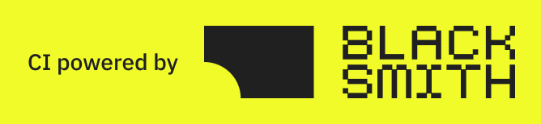

<!--
   - This Source Code Form is subject to the terms of the Mozilla Public
   - License, v. 2.0. If a copy of the MPL was not distributed with this
   - file, You can obtain one at http://mozilla.org/MPL/2.0/.
   -->

### `Whimsy`

Whimsy is a delightful, Arc-inspired browser built as an overlay fork of Zen Browser and Mozilla Firefox. Spaces, container-backed profiles, split views, and Mini Whimsy quick windows keep browsing organized, with a command bar and assignable keyboard shortcuts close at hand.

- A Private Space, private tabs, and locked spaces keep sensitive browsing separate.
- AI chat with tabs, page and PDF summaries, agents, and scheduled routines, with provider and permission controls in Settings.
- A Library for notes, downloads, screenshots, and archived tabs, plus Easel canvases for live page captures.
- Link hints, instant results, cookie banner blocking, and per-site controls for everyday browsing.

  <a href="https://github.com/ethankeshishian/whimsy/releases">
    Releases
  </a>
  •
  <a href="https://github.com/ethankeshishian/whimsy">
    Source
  </a>
  •
  <a href="https://github.com/ethankeshishian/whimsy/issues">
    Issues & Feedback
  </a>

### Download & Updates

Download the Apple silicon Mac `.dmg` from [Releases](https://github.com/ethankeshishian/whimsy/releases/latest), drag Whimsy to Applications, and open it. If macOS cannot verify the developer, use **System Settings → Privacy & Security → Open Anyway** for the first launch.

Whimsy downloads updates in the background and installs them on restart. Choose **Release** (the default) or **Dev** in **Settings → About Whimsy → Channel**. Dev builds appear as [pre-releases](https://github.com/ethankeshishian/whimsy/releases) and include changes before Release.

### Versions & Foundations

- Built on **Zen Browser** `1.24b`
- Powered by **Mozilla Firefox** (Gecko) `159.0`

### Credits & Licensing

Whimsy is an open-source project licensed under the [Mozilla Public License 2.0](http://mozilla.org/MPL/2.0/).

Whimsy is built on the incredible work of the [Zen Browser](https://zen-browser.app/) community and [Mozilla Firefox](https://www.mozilla.org/firefox/) contributors. We gratefully acknowledge and credit:

- The **Zen Browser Team** and contributors ([github.com/zen-browser/desktop](https://github.com/zen-browser/desktop)), licensed under MPL-2.0.
- The **Mozilla Foundation** and Firefox contributors ([mozilla.org](https://www.mozilla.org/)), licensed under MPL-2.0.
- Thanks to the sponsors and partners of Zen Browser for supporting open-source browser development:
  

### Feedback & Contributing

To report bugs or suggest enhancements, please open an issue on the [Whimsy GitHub Issues page](https://github.com/ethankeshishian/whimsy/issues).
