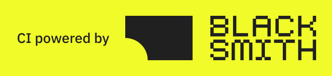

<!--
   - This Source Code Form is subject to the terms of the Mozilla Public
   - License, v. 2.0. If a copy of the MPL was not distributed with this
   - file, You can obtain one at http://mozilla.org/MPL/2.0/.
   -->

### `Whimsy`

Whimsy is a delightful, Arc-inspired browser built as an overlay fork of Zen Browser and Mozilla Firefox. It brings the power and ergonomics of Arc — spaces, container-backed profiles, split views, Mini Whimsy quick windows, link hints, instant results, and assignable keyboard shortcuts — to a fast, private, Gecko-powered engine.

  <a href="https://github.com/ethankeshishian/whimsy/releases">
    Releases
  </a>
  •
  <a href="https://github.com/ethankeshishian/whimsy">
    Source
  </a>
  •
  <a href="https://github.com/ethankeshishian/whimsy/issues">
    Issues & Feedback
  </a>

### Versions & Foundations

- Built on **Zen Browser** `1.24b`
- Powered by **Mozilla Firefox** (Gecko) `159.0`

### Credits & Licensing

Whimsy is an open-source project licensed under the [Mozilla Public License 2.0](http://mozilla.org/MPL/2.0/).

Whimsy is built on the incredible work of the [Zen Browser](https://zen-browser.app/) community and [Mozilla Firefox](https://www.mozilla.org/firefox/) contributors. We gratefully acknowledge and credit:

- The **Zen Browser Team** and contributors ([github.com/zen-browser/desktop](https://github.com/zen-browser/desktop)), licensed under MPL-2.0.
- The **Mozilla Foundation** and Firefox contributors ([mozilla.org](https://www.mozilla.org/)), licensed under MPL-2.0.
- Thanks to the sponsors and partners of Zen Browser for supporting open-source browser development:
  

### Feedback & Contributing

To report bugs or suggest enhancements, please open an issue on the [Whimsy GitHub Issues page](https://github.com/ethankeshishian/whimsy/issues).
